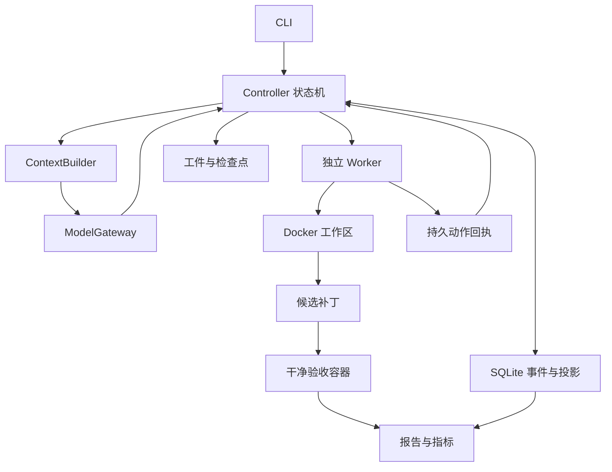

# Relay 开发方案

版本：0.1；初始日期：2026-10-18。本文定义完整 runtime 的目标设计；当前已实现前置教学切片，尚未完成 M0，最新能力见 [实现进度](08-project-status.md)。

### 1. 项目要回答的问题

Relay 面向长时间、多轮工具调用的代码修复任务。核心问题是：控制进程中断后，如何在已知的文件状态上继续工作，避免无依据地重做副作用，并保留完整成本与验证证据。

第二个问题是：稳定前缀、日志外置和历史摘要是否能改善费用与延迟，同时保持任务成功率。这个问题必须通过固定条件的对照实验回答，不能把 token 减少直接写成性能提升。

项目对应 Agent Infra、AI 平台和后端基础设施能力，包括状态机、持久化、进程管理、执行隔离、预算控制和评测。后续接推理服务与调度可以延伸到 AI Infra；当前阶段没有 GPU 算子或 CUDA 优化成果。

### 2. 需求与成功标准

项目目标是通过 coding agent harness 学习可恢复执行、成本控制与评测，形成可演示、可解释的工程成果，并为后续 Infra 工作提供基础。以下技术选择是目标设计；实际实现按学习切片推进。

| 目标 | MVP 交付物 | 验收方式 |
|---|---|---|
| 完成代码修复闭环 | CLI、patch、报告、事件轨迹 | 固定本地缺陷任务，干净环境应用补丁并通过隐藏验收 |
| 中断后可恢复 | 持久动作账本、Worker 回执、检查点 | 在动作关键窗口注入故障，恢复行为符合规范 |
| 副作用有边界 | 文件哈希核对、未知动作阻塞、回滚记录 | 没有静默重复写入；无法确认时显式停止 |
| 成本可追溯 | 请求账本、预留费用、未知用量标记 | 恢复不重置预算，重试与摘要都计入 |
| 策略可比较 | 三种上下文策略、固定任务清单 | 同模型同预算实验，原始结果可重算 |
| 可以展示与答辩 | 演示脚本、故障案例、实验报告 | 结论能追溯到版本、运行 ID 和工件 |

质量门槛先验证系统正确性。真实任务成功率、费用收益和恢复后最终成功率均作为测量结果，不预设漂亮数字作为必须达成的结论。

### 3. 范围

MVP 支持本地 Git 仓库的固定 commit、文本缺陷描述、Linux 容器中的代码修改与测试、单机顺序执行、一个真实模型适配器和一个离线脚本模型。模型提供商在首个真实调用前选择，业务核心不依赖其 SDK 类型。

运行目录与输入仓库分离；每个 run 使用独立副本。工作区内允许任意受限 shell 的代价是：该动作必须按可能有副作用处理，不能仅根据命令名称判断“只读”。可核对文件写入使用专用工具。

首版不包含 Web 控制台、多租户服务、跨机器调度、多 agent 合并、外部服务写入、训练管线、进程内存快照。Harbor/SWE-bench 接入放在本地闭环稳定之后，作为可选适配工作。

### 4. 架构与职责

| 模块 | 拥有的职责 | 不应承担的职责 |
|---|---|---|
| Controller | 状态转换、预算准入、恢复决策、取消协调 | 解析提供商专属响应、执行 shell |
| Store | 事务、事件序号、投影一致性、schema 版本 | 决定动作是否安全可重试 |
| Worker | 动作去重、执行身份、超时、进程清理、回执 | 选择下一步推理策略 |
| Sandbox | 工作区创建、容器资源、快照与重建 | 判断缺陷是否已修复 |
| ModelGateway | 请求适配、用量、错误归一化、调用时间 | 隐式无限重试、修改预算 |
| ContextBuilder | 基于事件生成消息、摘要与工件引用 | 删除原始事件、改变任务要求 |
| Verifier | 独立应用补丁、执行固定验收、分类结果 | 信任 agent 的成功声明 |
| Evaluator | 固定清单执行、故障计划、聚合指标 | 按结果好坏挑选报告样本 |

### 5. 技术默认值

建议 Python 3.12、asyncio、Pydantic、Typer、SQLite、Docker、pytest、Ruff、mypy，以及 uv 管理依赖。版本在 M0 环境探测后锁定；此处不是兼容性测试结果。

SQLite 放在宿主机本地磁盘，由 Controller 单写；Worker 将回执写入独立 spool，Controller 负责导入。这样控制器死亡时，Worker 仍可完成动作并落盘，且减少数据库多写者协调。启用 WAL 不会让多个写事务同时执行，仍需短事务与忙等待边界。[SQLite WAL 官方说明](https://www.sqlite.org/wal.html)

容器执行代码，宿主机运行控制面与模型客户端。容器不获得模型 API 密钥、宿主机 Docker socket、主目录或原始仓库的可写挂载。依赖在镜像准备阶段安装；任务运行阶段默认禁网。macOS 开发需记录容器 VM 的资源配额和目标架构，不能默认所有公开任务镜像都可在 arm64 原生运行。

### 6. 里程碑与完成门槛

按每周 12–15 小时估计 8–10 周，仅用于安排；阶段门槛优先于日期。

| 阶段 | 预计安排 | 开发内容 | 退出门槛 |
|---|---|---|---|
| M0 契约与环境 | 第 1 周前半 | 锁定依赖、探测 Docker、定义任务和事件 schema、离线模型 | 一个 fixture 能建立工作区并运行受控命令；无需 API 密钥 |
| M1 最小闭环 | 第 1–2 周 | 工具循环、单提供商、patch、独立验收、基础日志和预算 | 一个缺陷有完整闭环；10 个开发任务均有结果，失败保留原因 |
| M2 恢复内核 | 第 3–4 周 | 持久意图、独立 Worker、回执、文件核对、检查点 | 关键崩溃窗口均有自动测试；未知 shell 不会自动重跑 |
| M3 上下文策略 | 第 5–6 周 | 工件读取、固定前缀、两种摘要策略、token/费用统计 | 消息序列合法；摘要失败可回退或明确终止；三策略可切换 |
| M4 评测体系 | 第 7–8 周 | 冻结清单、故障计划、A/B/C/D 消融、失败分析 | 原始数据可重算；成本、失败、缺失值完整报告 |
| M5 展示与扩展 | 第 9–10 周 | 文档、演示、可选推理服务适配 | 全新环境可复现演示；简历描述有逐项证据 |

M1 的基础日志和预算不可留到 M3 才补：否则基线无法公平比较。M2 后若恢复协议仍存在未解释的副作用，不进入调度和多 agent 开发。

### 7. 资源与风险

首轮只跑离线模型和本地小 fixture，再进行单个真实任务试跑。根据实测单次费用估算完整实验支出：任务数 × 策略数 × 重复次数 × 平均费用，并加入失败重试与摘要费用。没有成本试跑前不默认启动大规模实验。

| 风险 | 处理方式 |
|---|---|
| 动作执行成功但回执丢失 | 专用写入核对；任意 shell 标为 UNKNOWN；停写并选择明确回滚 |
| 工作区与检查点不一致 | 停止写者后快照；校验 manifest；不接受半成品快照 |
| 提供商超时但已计费 | 保留未知请求和费用预留；不能记作零费用 |
| 本机不能运行目标镜像 | 先验证架构与依赖；固定可运行子集并披露筛选规则 |
| 摘要丢失关键约束 | 原始事件保留、摘要带引用、当前任务约束独立保存 |
| 验收被 agent 修改 | 独立验收镜像与隐藏测试，候选补丁不覆盖评分器 |
| 任务集过小或偏易 | 报告原始数量、失败分类和多次运行波动，限制结论范围 |

### 8. 后续 Infra 扩展门槛

1. 推理服务：M4 后接可控服务，记录 TTFT、输入/输出 token、并发和服务端指标。前缀缓存主要减少 prefill 工作，不能据此推断 decode 同等加速。[vLLM 官方说明](https://docs.vllm.ai/en/latest/features/automatic_prefix_caching/)
2. 调度：确实需要多 run 并发时，再增加队列、背压、租约、fencing token 和全局费用预留。
3. 沙箱池：测出环境准备占比较高后，再研究预热与缓存；验证任务之间无状态泄漏。
4. 多副本亲和路由：具备多个推理副本和可观测缓存指标后，对照轮询，联合评估吞吐、缓存收益与尾延迟。

每次只扩展一个方向，新增独立实验问题、基线和退出门槛。
